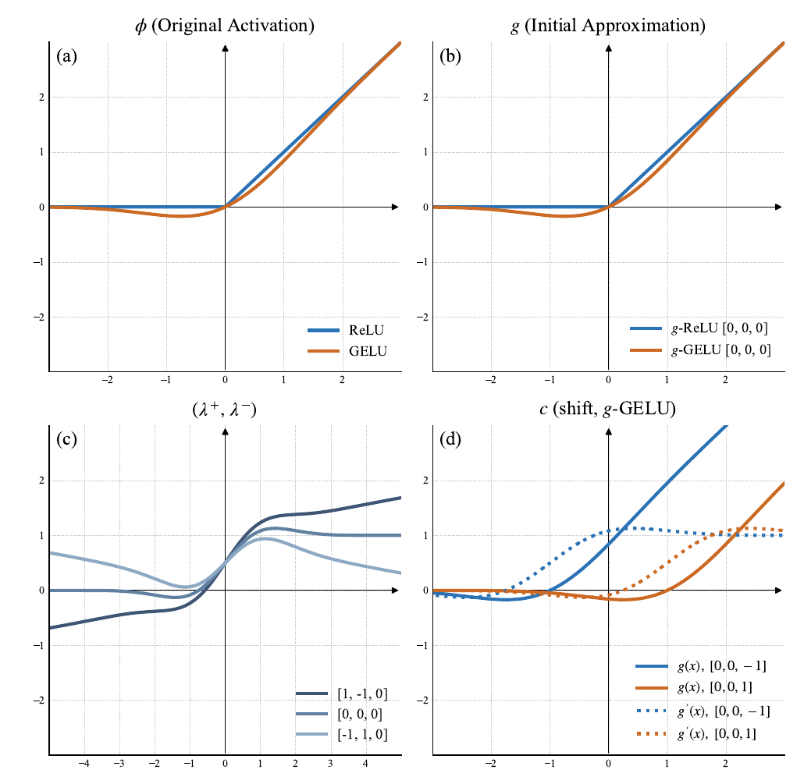

# AcTTA

**AcTTA: Rethinking Test-Time Adaptation via Dynamic Activation**

Hyeongyu Kim, Geonhui Han, Dosik Hwang · CVPR 2026

[Paper](https://arxiv.org/abs/2603.26096) ·
[Project page](https://hyeongyu-kim.github.io/actta/)

AcTTA adapts the center and slopes of activation functions during test-time
adaptation. This repository provides Source, TENT, and AcTTA-TENT experiments
on CIFAR-C and ImageNet-C.

<p align="center">
  
</p>

Activation parameterization ([Figure 1](https://arxiv.org/html/2603.26096v1#S3.F1)).

## Environment

Linux x86_64 · Python 3.12.2 · PyTorch 2.2.1 · CUDA 12.1 · timm 1.0.15.

```bash
cd code
conda create --name actta --file environment-conda-linux-64.lock.txt --yes
conda activate actta
python -m pip install -r requirements-depth-sweep.txt -r requirements-conda-extras.lock.txt
python tools/check_environment.py
```

The Conda lock includes the ImageNet-C JPEG decoder and native CUDA libraries.
Datasets and pretrained checkpoints are supplied separately. Download links,
preprocessing, and commands are in [Setup and execution](docs/REPRODUCIBILITY.md).

## Supported experiments

| Dataset | Backbone | Batch | AcTTA configuration |
|---|---|---:|---|
| CIFAR-10-C | WRN-28-10 | 128 | First WRN stage |
| CIFAR-100-C | WRN-40-2 | 128 / 4 | First two WRN stages |
| ImageNet-C | ResNet-50 (BN) | 128 | First 25/49 ReLU calls, LR 0.005, frozen BN affine |
| ImageNet-C | ViT-B/16 | 128 | First 6/12 MLP GELUs + all LN, LR 0.001, tanh GELU |
| ImageNet-C depth sweep | ResNet-50 / ViT-B/16 | 128 | 0/25/50/75/100%, LR 0.0025, frozen normalization affine |

At 50% depth, ResNet-50 adapts the first 25 independent ReLU call sites;
ViT-B/16 adapts the first 6 MLP GELUs. The joint-LN ViT configuration also
adapts all 25 LayerNorms. See [Architecture settings](docs/ARCHITECTURE.md).

Reference implementations for ETA/EATA, SAR, ROID, CMF, and DeYO are in
[reference/methods](code/reference/methods).

## Run

Run commands from `code/`.

ImageNet-C depth sweep:

```bash
python tools/run_suite.py imagenet-depth \
  --data-root /path/to/ImageNet-C \
  --resnet-checkpoint /path/to/resnet50-0676ba61.pth \
  --vit-checkpoint /path/to/jx_vit_base_p16_224-80ecf9dd.pth \
  --output output/depth_sweep --gpu 3
```

Use `imagenet-settings` with the same checkpoint arguments for architecture
configurations. Depth runs use fixed image-ID order; architecture runs use
shuffled order. Both use severity 5, batch 128, seed 1, and per-corruption resets.

CIFAR-C:

```bash
python tools/run_suite.py cifar \
  --data-root /path/to/DATA_ROOT --checkpoint-root /path/to/CHECKPOINT_ROOT \
  --output output/cifar --gpu 3
```

`--gpu` selects the physical GPU. Use a new or empty output directory.

## Reference results

Error (%), severity 5. CIFAR-10-C averages seeds 1, 2, and 3; other rows use
seed 1. Configurations are listed above.

| Dataset / backbone | Batch | TENT | AcTTA-TENT |
|---|---:|---:|---:|
| CIFAR-10-C / WRN-28-10 | 128 | 18.4276 | 17.0322 |
| CIFAR-100-C / WRN-40-2 | 128 | 35.4367 | 33.9793 |
| CIFAR-100-C / WRN-40-2 | 4 | 57.1500 | 54.8673 |
| ImageNet-C / ResNet-50 | 128 | 66.6027 | 64.3213 |
| ImageNet-C / ViT-B/16 | 128 | 53.4987 | 49.0547 |

Activation-depth results:


[Result tables and paper references](docs/RESULTS.md) ·
[Summary CSV](code/results/benchmark_summary.csv)

## Citation and licenses

```bibtex
@article{kim2026actta,
  title={AcTTA: Rethinking Test-Time Adaptation via Dynamic Activation},
  author={Kim, Hyeongyu and Han, Geonhui and Hwang, Dosik},
  journal={arXiv preprint arXiv:2603.26096},
  year={2026}
}
```

Code uses the [MIT license](LICENSE), with upstream notices retained in
[THIRD_PARTY.md](docs/THIRD_PARTY.md). The project website (`index.html`
and `static/`) retains its
[Creative Commons Attribution-ShareAlike 4.0 license](https://creativecommons.org/licenses/by-sa/4.0/).
