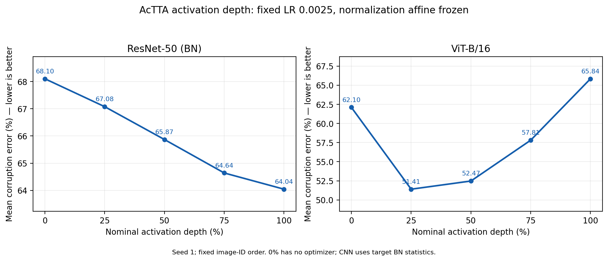

# Reference results

Errors are percentages; lower is better. ImageNet-C results use seed 1 and
batch 128; paper values are three-seed means. CIFAR-10-C TENT/AcTTA results
are means over seeds 1, 2, and 3; other CIFAR rows use seed 1.

## Ordered ImageNet-C depth sweep

Fixed image-ID order (`shuffle=False`), SGD LR 0.0025, momentum 0.9,
Nesterov=True, frozen normalization affine values, and per-corruption resets.
Each point covers 15 severity-5 corruptions × 5,000 images. At 0%, no optimizer
is used; ResNet retains batch BN statistics. Layer selection is in
[ARCHITECTURE.md](ARCHITECTURE.md).

Paper reference: [Table 4](https://arxiv.org/html/2603.26096v1#S4.T4).

| Depth | ResNet-50 | Paper | ViT-B/16 | Paper |
|---|---:|---:|---:|---:|
| 0% | 68.1027 | — | 62.1040 | — |
| 25% | 67.0773 | 67.02 | 51.4067 | 51.40 |
| 50% | 65.8693 | 65.89 | 52.4747 | 52.47 |
| 75% | 64.6400 | 63.45 | 57.8107 | 57.81 |
| 100% | 64.0440 | 63.47 | 65.8427 | 65.84 |

Files: [raw runs](../code/results/depth_sweep_runs),
[summary CSV](../code/results/depth_sweep_summary.csv),
[complete selected-layer manifest](../code/results/depth_sweep_layer_manifest.csv),
[per-corruption results](../code/results/depth_sweep_per_corruption.csv).

## ImageNet-C architecture and settings comparisons

Shuffled input (`shuffle=True`), momentum 0.9, zero dampening/weight decay,
and per-corruption resets. Nesterov=True unless labeled standard SGD.
Each configuration covers 15 severity-5 corruptions × 5,000 images.
Commands: `scripts/reproduce_architecture_audit.sh`.
Paper reference: [Table 5](https://arxiv.org/html/2603.26096v1#S4.T5).

| Configuration | Error (%) | Paper |
|---|---:|---:|
| RN50 TENT, LR 0.00025 | 66.6027 | 66.50 |
| RN50 AcTTA, 25 calls, LR 0.0025, frozen BN affine | 65.8760 | 64.95 |
| RN50 AcTTA, 17 ReLU modules, LR 0.005 | 65.0400 | 64.95 |
| ViT Source | 62.1040 | 62.10 |
| ViT TENT, LR 0.001 | 53.4987 | 53.85 |
| ViT AcTTA, 6 blocks + all LN, LR 0.001, tanh GELU | 49.0547 | 51.79 |
| ViT AcTTA, 6 blocks, frozen LN, LR 0.0025, tanh GELU | 50.1173 | 51.79 |
| ViT AcTTA, 6 blocks + all LN, LR 0.001, exact GELU | 48.9773 | 51.79 |
| RN50 AcTTA, 25 calls, LR 0.005, frozen BN affine | 64.3213 | 64.95 |
| ViT TENT, LR 0.001, standard SGD | 53.8227 | 53.85 |
| ViT AcTTA, 6 blocks + all LN, LR 0.001, exact GELU, standard SGD | 49.8147 | 51.79 |
| ViT AcTTA, 6 blocks + all LN, LR 0.00025, tanh GELU | 53.4707 | 51.79 |

Files: [raw runs](../code/results/architecture_runs),
[summary CSV](../code/results/architecture_audit_summary.csv),
[layer manifest](../code/results/architecture_layer_manifest.csv),
[per-corruption results](../code/results/architecture_per_corruption.csv).

## CIFAR-C

Each configuration covers 15 severity-5 corruptions × 10,000 images with
shuffled input and per-corruption resets. Models: WRN-28-10 on CIFAR-10-C,
WRN-40-2 on CIFAR-100-C. Adam LR is 0.001/0.01 for TENT/AcTTA at BS128;
BS4 rates are one tenth. AcTTA freezes BN affine values but uses batch statistics.
WRN28 adapts `block1`; WRN40 adapts `block1` and `block2`.

| Dataset / batch | Method | Seeds | Error (%) | Paper |
|---|---|---|---:|---:|
| CIFAR-10-C / BS128 | Source | 1 | 43.5167 | 43.52 |
| CIFAR-10-C / BS128 | TENT | 1, 2, 3 | 18.4276 | 18.51 |
| CIFAR-10-C / BS128 | AcTTA-TENT | 1, 2, 3 | 17.0322 | 17.03 |
| CIFAR-100-C / BS128 | Source | 1 | 46.7480 | 46.75 |
| CIFAR-100-C / BS128 | TENT | 1 | 35.4367 | 35.25 |
| CIFAR-100-C / BS128 | AcTTA-TENT | 1 | 33.9793 | 33.81 |
| CIFAR-100-C / BS4 | TENT | 1 | 57.1500 | 57.35 |
| CIFAR-100-C / BS4 | AcTTA-TENT | 1 | 54.8673 | 55.03 |

Files: [raw runs](../code/results/gpu2_runs),
[summary CSV](../code/results/gpu2_reproduction_summary.csv),
[per-corruption errors](../code/results/gpu2_per_corruption.csv).

## Additional ResNet-50 configurations

These configurations use the torchvision V1 checkpoint, BS128, seed 1,
all 15 severity-5 corruptions × 5,000 images, and the shuffled stream.
The residual-output configuration uses SGD momentum 0.9 with
**Nesterov=False**, TENT LR 0.00025, and AcTTA LR 0.005. AcTTA selects the
stem plus sixteen residual-output ReLUs. Source uses stored BN statistics
and no optimizer.

| RN50 setting | Error (%) |
|---|---:|
| Source | 82.0213 |
| TENT, standard SGD | 66.6693 |
| AcTTA, legacy 17-module selection, standard SGD | 65.1493 |

The shuffled RN50 depth profile uses `shuffle=True`, LR 0.0025,
Nesterov=True, and frozen BN affine values. Selected call counts are
0/13/25/38/49.

| Shuffled RN50 depth | Error (%) |
|---|---:|
| 0% | 68.1200 |
| 25% | 67.0813 |
| 50% | 65.8760 |
| 75% | 64.6653 |
| 100% | 64.1520 |

Files: [residual-output configuration runs](../code/results/imagenet_runs),
[shuffled depth runs](../code/results/depth_sweep_shuffled_pilot_runs),
and [summary CSV](../code/results/historical_results.csv).
